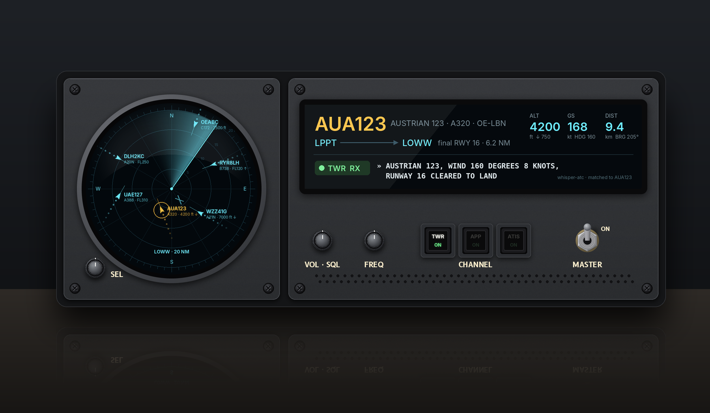

# VIE·SCOPE
**Air Traffic & Airband Monitor**

A desk instrument that shows the air traffic around Vienna on a round, radar-style scope, plays the airband radio and transcribes it live. Everything runs locally on a Raspberry Pi 5: no cloud, no subscription, no tablet look.

> **Status (Oct 2026):** parts ordered, hardware build starting. The image above is a concept render. Code, enclosure CAD and the full build guide will be published here once the unit works.

> **Fair warning: this is an expensive toy.** Parts so far come to roughly **€ 1400 including shipping**. Most of that goes into two SDR receivers, the antennas and two good displays. A basic ADS-B map with one RTL-SDR stick and a Pi costs a fraction of this. VIE·SCOPE is about the instrument-panel look and having voice and traffic in one box.

## What it does
- **Radar-style scope** on a 5" round display: live ADS-B traffic, received with its own antenna, around a fixed home position.
- **8.8" bar display**: details of the selected aircraft, a live transcript of the airband radio and the current ATIS.
- **Airband audio** through a built-in speaker, plus on-device speech-to-text with an ATC-tuned Whisper model.
- **Follow mode**: pick an aircraft with a knob, and VIE·SCOPE works out which frequency it is on from what it hears, including hand-offs ("contact Wien Radar 134.675").
- **Real controls**: concentric knobs, lit keys, a surplus mil-spec toggle as the master switch. Both displays have touch, but it is reserved for rarely used functions such as settings and service; day-to-day operation is all knobs and keys.

## Parts list
| Area | Part | Qty |
|---|---|---|
| Compute | Raspberry Pi 5, 8 GB · official Active Cooler · official 27 W USB-C supply · microSD | 1&nbsp;each |
| Control | Raspberry Pi Pico (knobs, keys, lighting via USB) | 1 |
| Displays | Waveshare 5" HDMI round 1080×1080, optically bonded | 1 |
| | Waveshare 8.8" DSI-TOUCH-A 480×1920, optically bonded | 1 |
| | Micro-HDMI → HDMI cable, 0.3 m | 1 |
| ADS-B 1090 MHz | FlightAware 1090 MHz antenna, 66 cm, N-female | 1 |
| | Uputronics 1090 MHz LNA with SAW filter | 1 |
| | Airspy Mini | 1 |
| | N→SMA adapter, SMA pigtails 30 cm + 15 cm, 5 m active USB 2.0 extension | 1&nbsp;set |
| Airband 118–137 MHz | Airspy R2 | 1 |
| | DIY half-wave dipole: 2 × Ø 4 mm brass rod, N panel socket, 4 clip-on ferrites | 1 |
| | RG58 coax, N → SMA, 5 m | 1 |
| Antenna mount | Floor-to-ceiling tension pole indoors at the window, two aluminium arms, printed collars | 1&nbsp;set |
| Audio | MAX98357A I²S amplifier · Visaton FRS 7 A 8 Ω full-range driver | 1&nbsp;each |
| Controls | SimFlight Services Dual Encoder Kit + Switch (ELMA E37 style), concentric knobs Ø 15/11 mm | 3 |
| | Kailh Clicky White MX switches · Adafruit relegendable keycaps · 3 mm white LEDs | 3&nbsp;each |
| | MS35058-24 toggle (FEME Milano), military surplus | 1 |
| | ULN2003A driver · 150 Ω resistors · 5 V COB LED strip (panel lighting) | 1&nbsp;set |
| Sensor | TSL2591 light sensor (auto-dimming) | 1 |
| Enclosure | Black PETG-CF (faces, trays), translucent white PETG (backlit labels, AMS inlay) | 1&nbsp;to&nbsp;2&nbsp;kg |
| | 2 × aluminium tube 20 × 10 mm (backbone rails) · black countersunk M3/M2 Phillips screws · heat-set inserts | 1&nbsp;set |

Printed on a Bambu Lab P2S with AMS. Labels are set in [B612](https://github.com/polarsys/b612), the font designed for Airbus cockpit displays.

## A note on airband
Receiving ADS-B and sharing it with feeder networks is common practice. Airband voice is different. VIE·SCOPE keeps audio and transcripts on the device: no streaming, no publishing, recording off by default. Check your local rules (in Austria: the TKG, telecommunications secrecy) before adding anything that leaves the device.
